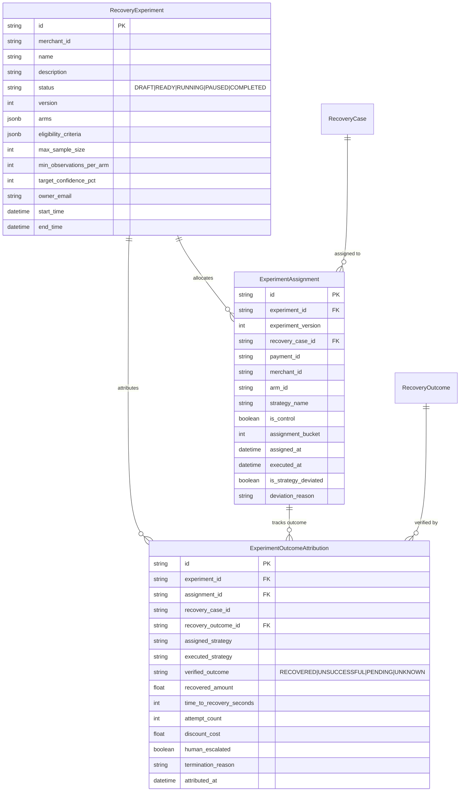
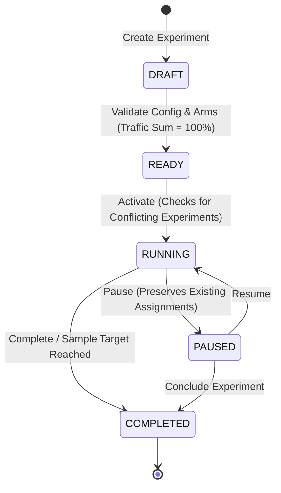

# PayRecover AI — Recovery Strategy Experimentation & Optimization Engine (Phase 6)

## 1. Executive Summary

Phase 6 implements a statistically grounded, safety-first experimentation platform for PayRecover AI. It enables merchant risk and growth engineering teams to design, launch, monitor, and evaluate controlled experiments on recovery strategies. 

Key principles:
1. **Deterministic Safety Invariants**: Experimental treatments can NEVER override, loosen, or randomize mandatory financial guardrails (such as high-value human approval >= Rs 50,000, merchant discount caps, max retry counts, or quiet hours). Any guardrail modification triggers an explicit strategy deviation record.
2. **Deterministic & Stable Assignment**: Case-to-arm allocation uses a cryptographic hash (`SHA-256(experiment_id:recovery_case_id:version)`) mapped across configured cumulative traffic splits. Retries, replays, and concurrent requests always produce identical assignments.
3. **Authoritative Outcome Attribution**: Recovery attribution is strictly coupled to authoritative payment states (`captured` from verified webhooks/providers). Pending and unverified cases are tracked separately and excluded from recovery rate denominators to prevent artificial metric deflation.
4. **Rigorous Statistical Inference**: 
   - 95% Wilson Score Confidence Intervals for binomial recovery rates.
   - Two-proportion z-tests with two-sided normal CDF p-values for hypothesis testing.
   - Welch's two-sample t-test for continuous recovery revenue per case.
   - Explicit sample-size safeguards and minimum observation requirements before declaring statistical significance.
5. **Safe Strategy Optimization**: Strategy evaluation incorporates experimental evidence only when sample sizes meet threshold criteria (N >= 30) and p-values demonstrate statistical significance (p < 0.05). Adaptive optimization utilizes offline Thompson Sampling with Beta priors (Beta(1 + recovered, 1 + unsuccessful)) to simulate performance before live deployment.

---

## 2. Database Schema & State Models

### 2.1 Entity Relationship Diagram



### 2.2 Experiment State Machine



- **Conflict Prevention**: No two `RUNNING` experiments within the same merchant can overlap on both payment method and failure category.
- **Assignment Guard**: Only `RUNNING` experiments accept new case assignments. Paused and completed experiments reject new assignments deterministically.

---

## 3. Assignment Engine & Hashing Protocol

Strategy assignment must be stable across worker instances, microservices, and network retries:

$$\text{hash} = \text{SHA256}(\text{experiment\_id} + \text{":"} + \text{case\_id} + \text{":v"} + \text{version})$$
$$\text{bucket} = \text{int}(\text{hash}[0:8], 16) \pmod{10000}$$

Arms define contiguous traffic slices spanning $[0, 10000)$.
For example:
- Control (50%): $[0, 5000)$
- Treatment A (50%): $[5000, 10000)$

```python
# Uniqueness & Concurrency Protection
# PostgreSQL UniqueConstraint('experiment_id', 'recovery_case_id')
```
If two concurrent worker threads attempt to assign the same recovery case simultaneously, the unique database constraint blocks the duplicate and loads the established record.

---

## 4. Outcome Attribution Rules

Outcomes are attributed strictly through the authoritative `RecoveryOutcome` records created upon payment capture:

1. **Attribution Window**: A strict 7-day window (604,800 seconds) is enforced between assignment and recovery. Captures occurring outside this window are attributed with `termination_reason="ATTRIBUTION_WINDOW_EXPIRED"`.
2. **Terminal vs Pending**:
   - `RECOVERED`: Authoritative payment capture verified via webhook or gateway query.
   - `UNSUCCESSFUL`: All retry attempts exhausted, customer explicitly opted out, or window closed.
   - `PENDING`: Payment or communication in-flight. **Excluded from recovery rate denominators**.
   - `UNKNOWN`: Transaction or gateway status indeterminate.
3. **Idempotency**: An existing outcome attribution record prevents duplicate attribution under webhook replays (`UniqueConstraint('experiment_id', 'recovery_case_id')`).
4. **Strategy Deviation Tracking**: When deterministic guardrails (such as high-value human approval) override an experimental assignment, `is_strategy_deviated = True` is recorded alongside `deviation_reason="GUARDRAIL_OVERRIDE_HIGH_VALUE_HUMAN_APPROVAL"`. Both assigned and executed strategies are logged for unbiased intention-to-treat (ITT) vs per-protocol analysis.

---

## 5. Statistical Methodology

### 5.1 Recovery Rate & Denominators

Let $k$ be the number of verified `RECOVERED` cases, and $n$ be the number of eligible terminal cases:
$$n = N_{\text{RECOVERED}} + N_{\text{UNSUCCESSFUL}}$$
$$\hat{p} = \frac{k}{n}$$
*Note: Pending and unknown cases are explicitly tracked but excluded from $n$ to prevent underestimating recovery efficacy during active cohorts.*

### 5.2 Wilson Score Interval (95% Confidence)

For each arm, the binomial proportion confidence interval is computed via the Wilson Score formulation:
$$w_{\pm} = \frac{\hat{p} + \frac{z^2}{2n} \pm z \sqrt{\frac{\hat{p}(1 - \hat{p})}{n} + \frac{z^2}{4n^2}}}{1 + \frac{z^2}{n}}$$
where $z = 1.95996$ for a two-sided 95% confidence level. The interval is strictly bounded within $[0.0, 1.0]$.

### 5.3 Hypothesis Testing (Two-Proportion Z-Test)

When comparing Treatment $A$ ($\hat{p}_A, n_A$) against Control $C$ ($\hat{p}_C, n_C$):

$$\text{Pooled Proportion } \hat{P} = \frac{k_A + k_C}{n_A + n_C}$$
$$\text{Standard Error } SE = \sqrt{\hat{P}(1 - \hat{P})\left(\frac{1}{n_A} + \frac{1}{n_C}\right)}$$
$$z = \frac{\hat{p}_A - \hat{p}_C}{SE}$$
$$p\text{-value} = 2 \times (1 - \Phi(|z|))$$

Statistical significance is declared only when:
1. $n_A \ge N_{\text{min}}$ and $n_C \ge N_{\text{min}}$ (default 30 per arm).
2. $p < 0.05$.

### 5.4 Revenue Comparison (Welch's Two-Sample t-Test)

To compare continuous recovered revenue per case between arms with unequal variances:
$$t = \frac{\bar{X}_A - \bar{X}_C}{\sqrt{\frac{s_A^2}{n_A} + \frac{s_C^2}{n_C}}}$$

---

## 6. Offline Optimization & Simulation

PayRecover AI forbids unverified live reinforcement learning from unilaterally changing customer financial terms. Strategy optimization follows a two-tier model:

1. **Evidence-Grounded Policy Tuning**:
   - The `StrategyEvaluationEngine` inspects completed experiments matching the failure category and payment method.
   - Significant experimental winners ($p < 0.05$) receive an empirical boost proportional to relative lift:
     $$\Delta_{\text{score}} = \min(15.0, \text{lift} \times 20.0)$$
   - Inconclusive or under-powered experiments apply no production modification.

2. **Offline Simulation Framework**:
   - Merchants can evaluate historical cases against candidate strategies using Monte Carlo Thompson Sampling:
     $$\theta_i \sim \text{Beta}(1 + k_i, 1 + n_i - k_i)$$
   - Computes expected revenue recovery, allocation distributions, and simulated regret without customer risk.

---

## 7. API Reference

| Endpoint | Method | RBAC Roles | Description |
|---|---|---|---|
| `/api/experiments` | `GET` | Admin, Risk Analyst, Operator, Viewer | List experiments with filtering & pagination |
| `/api/experiments` | `POST` | Admin, Risk Analyst | Create a new experiment in `DRAFT` status |
| `/api/experiments/{id}` | `GET` | Admin, Risk Analyst, Operator, Viewer | Inspect experiment specification & arms |
| `/api/experiments/{id}` | `PUT` | Admin, Risk Analyst | Update experiment properties (only while `DRAFT`/`READY`) |
| `/api/experiments/{id}/validate` | `POST` | Admin, Risk Analyst | Validate traffic splits, criteria, and guardrail rules |
| `/api/experiments/{id}/status` | `POST` | Admin, Risk Analyst | Transition status (`READY`, `RUNNING`, `PAUSED`, `COMPLETED`) |
| `/api/experiments/{id}/assignments` | `GET` | Admin, Risk Analyst, Operator | View recent assignment stream and deviations |
| `/api/experiments/{id}/metrics` | `GET` | Admin, Risk Analyst, Operator, Viewer | Compute statistical metrics, Wilson intervals, & z-tests |
| `/api/experiments/simulate` | `POST` | Admin, Risk Analyst | Run deterministic offline simulation on historical cases |
| `/api/experiments/{id}/export` | `GET` | Admin, Risk Analyst | Export sanitized audit log and outcome attribution records |
