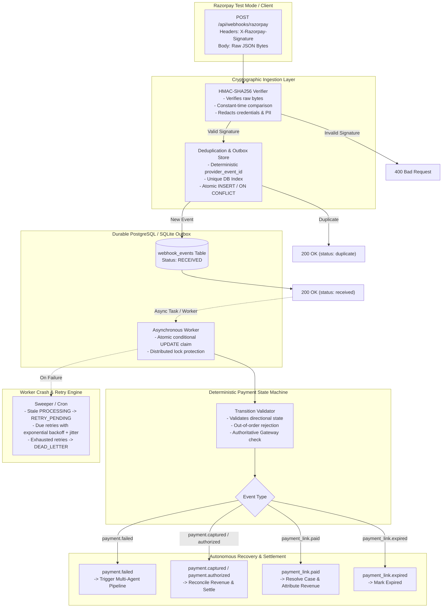

# PayRecover AI — Production Webhook Processing & Event-Driven Architecture

## 1. System Overview

PayRecover AI provides an enterprise-grade, verified Razorpay webhook ingestion and durable event processing engine designed to the standards of tier-1 fintech infrastructure (Razorpay, PayPal, Stripe).



---

## 2. Webhook Security Architecture

### Cryptographic HMAC-SHA256 Signature Verification
1. **Raw Body Integrity**: The signature is verified against the **exact unparsed raw bytes** of the HTTP request payload (`request.body()`). Parsing to JSON before signature calculation is strictly avoided to protect against whitespace, encoding, and key ordering alterations.
2. **Constant-Time Comparison**: `hmac.compare_digest(expected_signature, received_signature)` prevents timing side-channel attacks.
3. **Secret Enforcement**: If `RAZORPAY_WEBHOOK_SECRET` is unset, empty, or whitespace, incoming webhooks are rejected with `400 Bad Request` and an error is logged.
4. **Secret Redaction**: Raw signatures, secrets, API keys, card PANs, and CVVs are strictly redacted from structured logs and serialized event metadata via `RazorpayWebhookVerifier.sanitize_payload`.

---

## 3. Durable Event Processing & Outbox Pattern

### State Machine for Webhook Events
Every received webhook event transitions through explicit lifecycle states:

```
[ INCOMING ] ──► RECEIVED ──► PROCESSING ──► PROCESSED (Terminal)
                                 │
                                 ▼ (On Error)
                            RETRY_PENDING ──► DEAD_LETTER (Max Retries)
                                 │
                                 └──► (Backoff Due) ──► PROCESSING
```

| Status | Description |
| :--- | :--- |
| `RECEIVED` | Durably recorded in the database prior to HTTP 200 acknowledgment. |
| `PROCESSING` | Atomically claimed by an active worker thread. |
| `PROCESSED` | Business logic executed and state machine verified successfully. |
| `RETRY_PENDING` | Transient failure encountered; scheduled for retry with exponential backoff and jitter. |
| `FAILED` | Event encountered a terminal validation failure. |
| `DEAD_LETTER` | Event exhausted maximum attempt threshold (default 5 retries); requires operator inspection. |

### Concurrency Protection & Atomic Worker Claiming
- **Deduplication Constraint**: `provider_event_id` is unique in the database. Concurrent deliveries of the identical event are caught via `IntegrityError` rollback, gracefully returning `200 OK` with status `duplicate`.
- **Atomic Claim**: Workers claim jobs using conditional status updates (`UPDATE webhook_events SET status = 'PROCESSING', attempt_count = attempt_count + 1 WHERE id = :id AND status IN ('RECEIVED', 'RETRY_PENDING')`). If zero rows are updated, duplicate execution is immediately avoided.
- **Worker Crash Recovery**: `recover_stale_events(stale_threshold_seconds=300)` identifies events stuck in `PROCESSING` status for longer than the timeout threshold (e.g. following process death or container restart) and safely resets them to `RETRY_PENDING`.

---

## 4. Payment State Machine Rules

The `PaymentStateMachine` enforces directional integrity to prevent out-of-order provider webhooks from reversing settled revenue:

| Current Status | Allowed Target Statuses | Rules & Enforcements |
| :--- | :--- | :--- |
| `PENDING` | `SUCCESS`, `FAILED`, `ABANDONED`, `RECOVERED` | Standard checkout progression. |
| `FAILED` | `RECOVERED`, `SUCCESS` | Eligible for autonomous recovery or manual settlement. |
| `ABANDONED` | `RECOVERED`, `FAILED`, `SUCCESS` | Customer returns via recovery link or checkout retry. |
| `SUCCESS` | *(Terminal)* | **Immutable.** Late `payment.failed` webhooks are rejected and ignored. |
| `RECOVERED` | *(Terminal)* | **Immutable.** Once recovered, no event can downgrade the transaction. |

### Authoritative Gateway State Checks
When event sequence or timestamp ordering is ambiguous, the system invokes `RazorpayClientWrapper.fetch_payment(payment_id)` to query the authoritative gateway state rather than guessing.

---

## 5. Operational REST Endpoints

All operational endpoints enforce Role-Based Access Control (RBAC):

| Method | Endpoint | Minimum Role | Description |
| :--- | :--- | :--- | :--- |
| `POST` | `/api/webhooks/razorpay` | Public | Signature-verified webhook ingestion endpoint. |
| `POST` | `/api/recovery/webhook` | Public | Backwards-compatible alias for legacy configurations. |
| `GET` | `/api/webhooks/events` | `VIEWER` | Paginated event list with `status` and `event_type` filtering. |
| `GET` | `/api/webhooks/events/{id}` | `VIEWER` | Detailed view of an event with sanitized payload. |
| `GET` | `/api/webhooks/failed` | `VIEWER` | List of failed, retry-pending, or dead-letter events. |
| `POST` | `/api/webhooks/events/{id}/retry` | `OPERATOR` | Safely resets and re-executes an eligible failed event. |
| `GET` | `/api/webhooks/health` | `VIEWER` | Real-time health statistics, backlog size, and secret status. |
| `POST` | `/api/webhooks/sweep` | `OPERATOR` | Sweeps stale jobs and executes due retry backlogs. |

---

## 6. Razorpay Test Mode Setup Guide

To link your Razorpay Dashboard in Test Mode:

1. **Log in to Razorpay**: Navigate to the [Razorpay Dashboard](https://dashboard.razorpay.com) and switch to **Test Mode** (toggle in the top-left corner).
2. **Navigate to Webhooks**: Go to **Settings** $\rightarrow$ **Webhooks** $\rightarrow$ Click **Add New Webhook**.
3. **Webhook URL**:
   - For local development with a tunnel (ngrok / Localtunnel):  
     `https://<your-subdomain>.ngrok-free.app/api/webhooks/razorpay`
   - For internal network / staging:  
     `http://<your-server-ip>:8000/api/webhooks/razorpay`
4. **Secret**: Enter a strong secret matching `RAZORPAY_WEBHOOK_SECRET` in your `.env` (default: `rzp_webhook_secret_sample_12345`).
5. **Select Active Events**:
   - [x] `payment.authorized`
   - [x] `payment.captured`
   - [x] `payment.failed`
   - [x] `payment_link.paid`
   - [x] `payment_link.expired`
6. **Save Webhook**: Click **Create Webhook**. Trigger a test payment in Test Mode; the event will appear in real time in the **Webhook Processing Console**.
